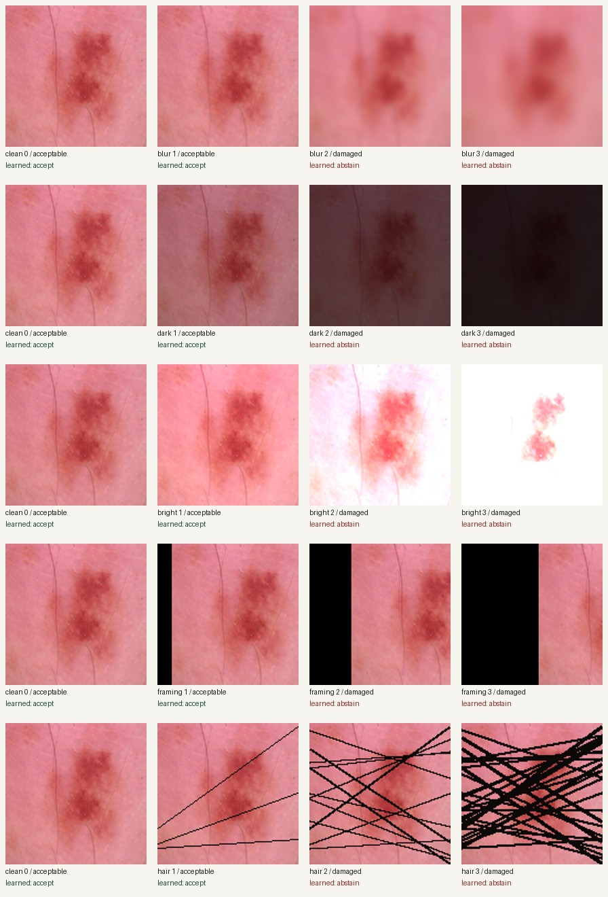
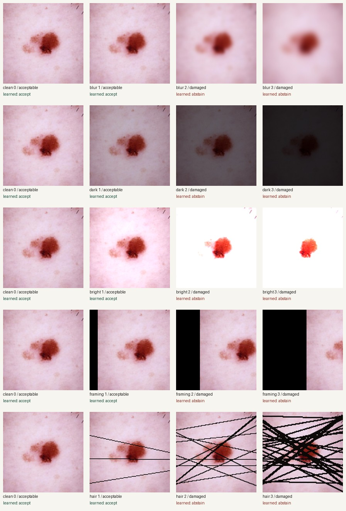

# Photo quality gate: saved experiment

Not a diagnostic tool. This is a synthetic-damage research demonstration.

## What was tested

The frozen sample has 360 unique lesions, balanced between nevus and melanoma. Each source appears once. The source split is 216 training, 72 validation and 72 test. Each held-out source has 16 versions, giving 1152 held-out photo versions. These versions are correlated; they are not independent patients.

Clean and strength 1 are operationally labelled acceptable; strengths 2 and 3 are labelled damaged. These are chosen benchmark labels, not clinical ratings. Original images may already contain quality defects. Transformations run after resizing the complete image to a square analysis grid.

## Gate comparison

| Gate | Damaged rejected | Acceptable retained | Photos accepted | Lesion accuracy: accepted | Lesion accuracy: rejected |
|---|---|---|---|---|---|
| rules | 683/720 (94.9%) | 400/432 (92.6%) | 437/1152 (37.9%) | 308/437 (70.5%) | 380/715 (53.1%) |
| learned | 703/720 (97.6%) | 392/432 (90.7%) | 409/1152 (35.5%) | 280/409 (68.5%) | 408/743 (54.9%) |

Without a gate the lesion baseline gets 688/1152 (59.7%) across all versions; on clean test images it gets 59/72 (81.9%). The public baseline is the logistic classifier in this repository, trained from scratch on clean training sources using colour histograms and a small spatial colour grid. It is not an externally pretrained or clinically validated model.

Rejection means abstention in the check command. Rejected-image lesion scores are computed only inside this benchmark, to measure what the gate discards.

## Detection at each known strength

Cells show rejected / total. For clean and strength 1 this is false rejection. For strengths 2 and 3 it is detection of operationally unacceptable damage.

| Damage | Strength | Synthetic setting | Rules rejection | Learned rejection | Ungated lesion accuracy |
|---|---|---|---|---|---|
| clean | 0 | unchanged | 5/72 (6.9%) | 3/72 (4.2%) | 59/72 (81.9%) |
| blur | 1 | 0.6 | 4/72 (5.6%) | 11/72 (15.3%) | 58/72 (80.6%) |
| blur | 2 | 2.0 | 72/72 (100.0%) | 72/72 (100.0%) | 57/72 (79.2%) |
| blur | 3 | 4.0 | 72/72 (100.0%) | 72/72 (100.0%) | 56/72 (77.8%) |
| dark | 1 | 0.8 | 2/72 (2.8%) | 16/72 (22.2%) | 52/72 (72.2%) |
| dark | 2 | 0.4 | 37/72 (51.4%) | 69/72 (95.8%) | 30/72 (41.7%) |
| dark | 3 | 0.15 | 72/72 (100.0%) | 72/72 (100.0%) | 20/72 (27.8%) |
| bright | 1 | 1.15 | 9/72 (12.5%) | 3/72 (4.2%) | 51/72 (70.8%) |
| bright | 2 | 1.8 | 70/72 (97.2%) | 63/72 (87.5%) | 37/72 (51.4%) |
| bright | 3 | 2.8 | 72/72 (100.0%) | 72/72 (100.0%) | 36/72 (50.0%) |
| framing | 1 | 0.1 | 7/72 (9.7%) | 7/72 (9.7%) | 36/72 (50.0%) |
| framing | 2 | 0.3 | 72/72 (100.0%) | 72/72 (100.0%) | 36/72 (50.0%) |
| framing | 3 | 0.55 | 72/72 (100.0%) | 72/72 (100.0%) | 36/72 (50.0%) |
| hair | 1 | 3 | 5/72 (6.9%) | 0/72 (0.0%) | 52/72 (72.2%) |
| hair | 2 | 12 | 72/72 (100.0%) | 67/72 (93.1%) | 36/72 (50.0%) |
| hair | 3 | 28 | 72/72 (100.0%) | 72/72 (100.0%) | 36/72 (50.0%) |

Blur settings are Gaussian radii in analysis pixels. Dark/bright settings multiply RGB values, not physical exposure stops. Framing settings shift that fraction of the original field off the canvas and pad black. Hair settings are line counts, with line widths equal to strength in analysis pixels.

## Selection bias and uncertainty

| Gate | Source diagnosis | Accepted lesion accuracy | Rejected lesion accuracy |
|---|---|---|---|
| rules | nevus | 117/220 (53.2%) | 66/356 (18.5%) |
| rules | melanoma | 191/217 (88.0%) | 314/359 (87.5%) |
| learned | nevus | 106/217 (48.8%) | 77/359 (21.4%) |
| learned | melanoma | 174/192 (90.6%) | 331/384 (86.2%) |


rules: the accepted-minus-rejected accuracy difference has a 95% source-bootstrap interval of 10.9 to 23.4 percentage points (500/500 valid resamples).


learned: the accepted-minus-rejected accuracy difference has a 95% source-bootstrap interval of 8.3 to 19.1 percentage points (500/500 valid resamples).


The bootstrap resamples lesions and keeps all their versions together. It describes this small fixed experiment, not a clinical population. Accepted and rejected groups differ in damage and class mix, so the accuracy difference does not establish a causal benefit. The threshold curve in metrics.json shows the trade-off between keeping images and selective accuracy, including empty groups.

## Example images

These are the first held-out IDs alphabetically in each class, selected without looking at scores. Each row repeats the original and shows increasing damage. Captions include the operational label and the learned gate's actual decision.



ISIC_0024307: Nevus. Attribution: MILK study team. CC BY-NC 4.0. Resized and synthetically modified here. [Source](https://api.isic-archive.com/api/v2/images/ISIC_0024307/) · [Licence](https://creativecommons.org/licenses/by-nc/4.0/)



ISIC_0024313: Melanoma, NOS. Attribution: MILK study team. CC BY-NC 4.0. Resized and synthetically modified here. [Source](https://api.isic-archive.com/api/v2/images/ISIC_0024313/) · [Licence](https://creativecommons.org/licenses/by-nc/4.0/)

## Reproduce and inspect

```sh
uv sync --frozen
uv run image-qc reproduce --output reports
uv run pytest -q
```

See predictions.csv for each test decision and raw measurement; models.json for coefficients and validation thresholds; splits.json for source partitions; metrics.json for unrounded counts, rates and uncertainty. All images are checksum-verified against data/manifest.json. The manifest preserves per-image licence, attribution and source URLs without demographic fields.

## Limits

This is a small, deliberately balanced, deterministic convenience sample from the HAM10000 archive collection, not a random population sample. Lesion IDs and exact image hashes are disjoint; patient independence and near-duplicate independence are not established. The experiment uses isolated synthetic corruptions, not mixed artifacts or real capture failures. Black-padded framing is easy to detect and does not measure true lesion coverage. The coverage check measures nonblack field area, not a medical segmentation mask. The hair response is a thin-dark-line proxy. Neither gate checks diagnosis, skin tone fairness, device shift or clinical adequacy. The baseline can be wrong on accepted photos. A positive result here does not make a photo safe to analyse.

## Source

Tschandl, P., Rosendahl, C. & Kittler, H. The HAM10000 dataset, a large collection of multi-source dermatoscopic images of common pigmented skin lesions. Scientific Data (2018). https://doi.org/10.1038/sdata.2018.161. Images from https://api.isic-archive.com/api/v2/collections/212/ under https://creativecommons.org/licenses/by-nc/4.0/. All displayed examples are noncommercial adaptations; the image licence is separate from the code licence.
